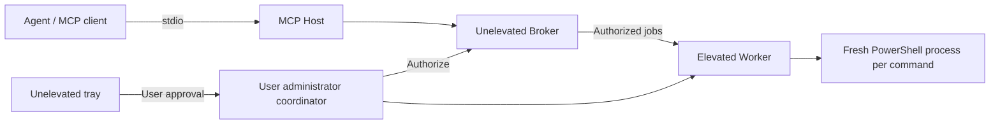
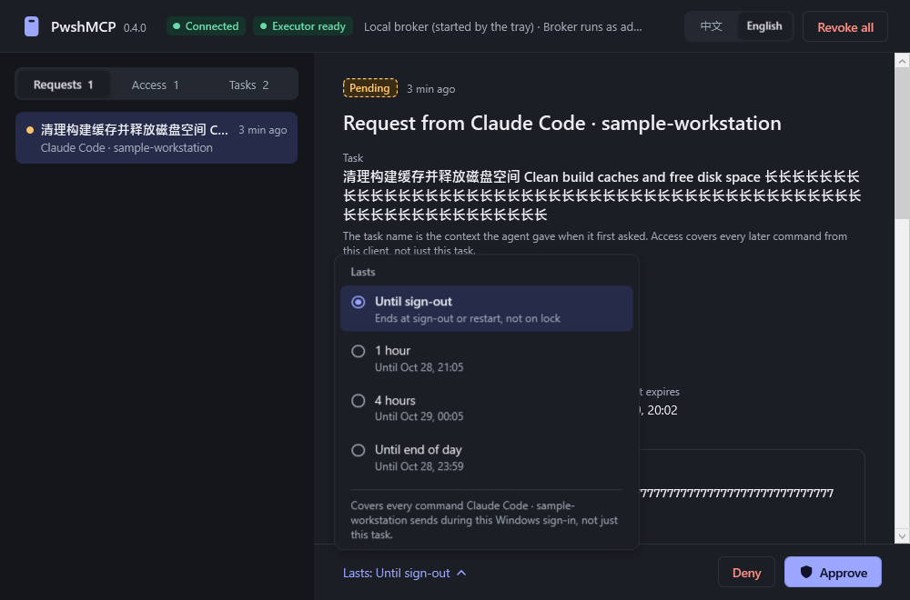

<div align="center">


# PwshMCP

**A Windows PowerShell MCP server for local agents**<br>
Approve elevated commands in the tray instead of a UAC prompt per command. Independent commands start in a fresh environment by default.

[](#requirements)
[](#requirements)
[](#mcp-tools)
[](#version-note)
[](https://github.com/MindCastlePlayground/PwshMCP/releases)

[中文](README.md) · **English**

[Quick start](#quick-start) · [MCP tools](#mcp-tools) · [Trust boundaries](#trust-boundaries) · [Documentation](#documentation) · [Issues](https://github.com/MindCastlePlayground/PwshMCP/issues)

</div>

---

PwshMCP consists of a local stdio MCP server and a Windows tray app. You authorize installation as administrator once, which sets up a background elevated execution entry point for the **current user**. New requests appear in a native window without stealing focus. Pick a lifetime and approve there, or use the tray.

The tray menu can approve one request or all current requests and enable manual Do Not Disturb. Automatic muting is on by default during full screen, presentations and other Windows busy states. Pending indicators remain visible, and deferred requests share one notification when muting ends. Approve all applies only to the current list, never future arrivals. See [notification behavior](docs/NOTIFICATIONS.md).

<a id="version-note"></a>

> [!IMPORTANT]
> **This page describes 0.4.0 in source.** As of 2026-10-28, the latest GitHub release package is still **0.3.0**. It lacks the full desktop coordinator and the latest UI described here. [Build from source](#quick-start) using the steps below; check each [release](https://github.com/MindCastlePlayground/PwshMCP/releases) for what it actually contains.

## Features

- **Fewer UAC prompts.** You elevate once during installation. Routine elevated requests are approved in the unelevated tray, with a lifetime of until sign-out, 1 hour, 4 hours or end of day.
- **A fresh environment per command.** By default each command gets a new process and a rebuilt environment. It sees environment variables you just changed and never inherits temporary variables from a previous shell.
- **Explicit state when you need it.** Pass `session` to keep variables, functions and the current directory. Rebuild with `session_reset`.
- **Requests, access and jobs in plain sight.** See requests and output by task name, command description and client name. Deny, revoke or cancel at any time.
- **Every call explains itself.** Every command requires `description`. The first elevated request also requires `taskName`.
- **Bilingual desktop UI.** Switch between 中文 and English. Includes wrapped PowerShell syntax highlighting and original-text copy.

## How it works



- In desktop mode, normal commands take the unelevated path.
- The administrator coordinator is started by a highest-privilege logon task registered at installation. It runs as the **current administrator user**. User commands never run as SYSTEM.
- The coordinator validates the tray's installed executable path, user SID and Windows session. **MCP exposes no approval tool.** Routine approvals are made by the user in the tray.

## Tray approval UI

<p align="center">
  
</p>

<p align="center"><sub>
Illustration of a pending 0.4.0 request with the “Lasts” lifetime picker open. It is an offline rendering of the real WPF controls, filled with synthetic data that stress-tests long-text wrapping, not real activity. It predates the latest scrollbar styling, so details may differ slightly from the current build.
</sub></p>

## Quick start

### Requirements

| Item | Requirement |
| --- | --- |
| System | Windows desktop, with the **interactively signed-in** user in the Administrators group |
| Build | .NET 8 SDK |
| Run | .NET 8 Desktop Runtime |
| PowerShell | Installed PowerShell 7 is preferred; otherwise the system Windows PowerShell is used |

> [!NOTE]
> You can only install for **yourself**. Installing for a standard user through another administrator account is unsupported. Desktop mode and the legacy service mode cannot be installed together.

**1. Build**

```powershell
git clone https://github.com/MindCastlePlayground/PwshMCP.git
cd PwshMCP
powershell -NoProfile -File scripts/build.ps1 -Output artifacts/package
```

**2. Install desktop mode.** Open administrator PowerShell **as the same Windows user**, change to the repository directory, then run:

```powershell
$sid = [Security.Principal.WindowsIdentity]::GetCurrent().User.Value
powershell -NoProfile -File scripts/install-desktop.ps1 -UserSid $sid -Source artifacts/package
```

The installer:

- installs into the protected `%ProgramFiles%\PwshMCP`;
- registers the highest-privilege logon task `PwshMCP-Admin-<SID>` and a per-user (HKCU) tray startup entry;
- **stores no password**.

It refuses to continue while PwshMCP processes are still running from the target directory, or when it detects the legacy service mode.

**3. Open the tray** from **ordinary, unelevated** PowerShell:

```powershell
& "$env:ProgramFiles\PwshMCP\PwshMcp.Tray.exe" --show
```

Once you see “Connected” and “Executor ready”, installation is done.

> [!NOTE]
> “One UAC” refers to routine approval and execution after installation. Installing, upgrading or replacing protected programs still requires administrator privileges.

**4. Connect your agent.** For stdio MCP hosts. Adjust the path if you installed on another drive:

```json
{
  "mcpServers": {
    "pwsh": {
      "command": "C:/Program Files/PwshMCP/PwshMcp.Host.exe",
      "args": ["mcp", "--client", "codex", "--display-name", "Codex"]
    }
  }
}
```

Equivalent Codex `config.toml` entry:

```toml
[mcp_servers.pwsh]
command = 'C:/Program Files/PwshMCP/PwshMcp.Host.exe'
args = ["mcp", "--client", "codex", "--display-name", "Codex"]
```

- `--client` is the client key that grants are tied to. Use distinct, stable values for different clients. A reconnect does not need new authorization just because the PID changed. It is **not authentication**.
- `--display-name` only affects what the UI shows.
- Reconnect MCP after changing the configuration.

**5. Make your first elevated call.** Example `run` tool arguments:

```json
{
  "code": "Get-Service | Select-Object -First 10 Name, Status",
  "description": "Inspect services to investigate a background service startup issue",
  "taskName": "Investigate background services",
  "privilege": "elevated"
}
```

The request waits in the tray for approval. Choose a lifetime and approve, and later commands from the same client reuse that grant. `run` returns job information right away; get results with `status` and `output`.

> Normal commands run with ordinary privileges by default and do not require a tray administrator grant. This example demonstrates the approval flow.

## MCP tools

| Tool | Purpose |
| --- | --- |
| `run` | Run a command. Ordinary privileges and a fresh environment by default; supports `privilege`, `session`, `context`, `cwd`, `env` |
| `status` · `output` · `cancel` | Inspect status, read incremental output, request cancellation |
| `request_access` · `grants` | Request administrator access; inspect grants and job state |
| `session_reset` · `session_close` | Rebuild or close a persistent shell; requires an action description |
| `context_set` · `context_clear` | Name a set of environment overrides (the name goes in the `session` parameter) for fresh processes started with `run(context=...)` |
| `env_info` | Inspect environment sources and override names without secret values |

**Which one?** By default every command runs on its own. Use a context to pass a few values between commands. Use a session only when you really need the whole shell state (variables, functions, directory).

## Trust boundaries

This section explains grant scope, the effects of revocation and how audit data is stored.

**Grant scope**

- A grant is bound to **client key + user SID + the current Windows sign-in**. It covers later elevated commands requested by that client, **not just one task name or one command**.
- Neither `--client` nor `--display-name` is an authenticated model identity. PwshMCP does not promise isolation from malicious processes running as the same user.

**Execution power**

- Approved elevated scripts have real administrator power. Fresh environments are **not a security sandbox**.
- User commands never run as SYSTEM.
- Revocation only blocks new dispatches. It **does not roll back system changes that already happened and does not stop running commands**; cancel those separately.

**Lifetime**

- Locking the screen does **not** end access. Signing out ends elevated execution. After expiry or revocation, no new jobs are dispatched.
- A Broker restart invalidates all pending and active grants. Unfinished jobs are marked “outcome unknown” and are **never rerun automatically**.
- If the connection or executor is offline, click its header status or **Repair connections** in the tray menu. Try reconnecting or starting the registered executor first. Only the explicit administrator fallback opens UAC. Restarting the local broker invalidates current grants and requires confirmation in the window. See [recovery UI notes](docs/UI-RECOVERY.md).
- The agent host's own approval rules stay independent. PwshMCP does not turn them off for you.

**Data and identity**

- Task names, descriptions, directories and other metadata persist for auditing. Command bodies, environment values and output are not written to the Broker state archive. That does not mean they stay secret everywhere: the runtime and clients still process them, so keep credentials out of descriptions.
- Model names self-reported through tool arguments are not accepted, and access is never granted by model name. Host-log evidence tooling is verified, but **automatic per-call model attribution is not integrated yet**. Automatic discovery or preapproval of arbitrary agent sessions is not implemented.

## Upgrade and uninstall

**Upgrade:** finish your jobs and close all PwshMCP processes in the installation directory, then rerun the desktop installer as the same user with administrator rights. The installer backs up the previous files. Because the Broker restarts, you will need to approve again.

**Uninstall:** from administrator PowerShell:

```powershell
powershell -NoProfile -File scripts/uninstall-desktop.ps1
# Add -RemoveFiles to remove the path-checked program files as well.
```

Uninstalling does not undo changes that commands made to the system. The legacy service mode uses separate scripts and cannot coexist with desktop mode. For new installations, use the desktop workflow on this page; see the [installation contract](docs/UAC-0.4-CONTRACT.md) (Chinese).

## Verification status

| Scope | Status |
| --- | --- |
| Desktop installation, real normal/elevated commands, fresh environments | Verified on the development machine (0.4.0) |
| Latest offline UI checks | **815 self-tests and 1039 render checks pass** |
| Logon startup, lock/sign-out, touch, actual high DPI, etc. | Some cases not yet verified |

Offline rendering is not live interaction testing, and none of this is an independent security audit. Full details are in the [0.4.0 acceptance record](docs/ACCEPTANCE-0.4.0.md) (Chinese).

## Documentation

The detailed engineering records below are currently written in **Chinese**.

| Topic | Documents |
| --- | --- |
| Design | [Design baseline](docs/BASELINE.md) · [Coordinator and installation contract](docs/UAC-0.4-CONTRACT.md) |
| UI | [UI behavior and checks](docs/UI-0.4.0.md) |
| Verification | [Environment verification](docs/ENVIRONMENT-RESULT.md) · [0.4.0 acceptance record](docs/ACCEPTANCE-0.4.0.md) |
| Identity | [Model evidence](docs/MODEL-EVIDENCE.md) · [Agent identity boundary](docs/AGENT-IDENTITY.md) |
| Releases | [Releases](https://github.com/MindCastlePlayground/PwshMCP/releases) |

## Contributing

Issues and pull requests are welcome. When reporting a problem, include the version, Windows / PowerShell versions, reproduction steps and redacted errors. **Do not upload credentials, real command output or full session logs.** See [CONTRIBUTING.md](CONTRIBUTING.md).

## License

A license has not been chosen yet. Until a license file is added to the repository, public visibility alone does not grant open-source usage rights.
