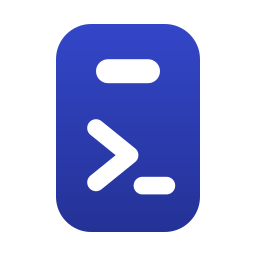
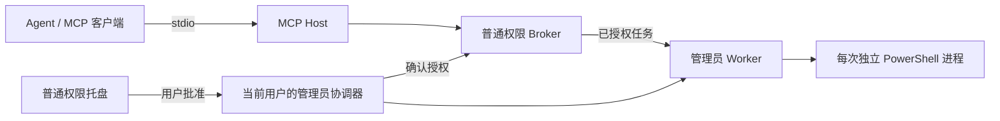
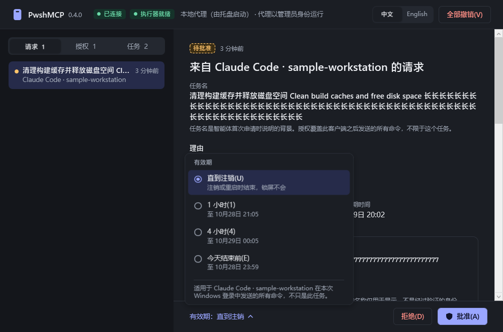

<div align="center">



# PwshMCP

**面向本地 Agent 的 Windows PowerShell MCP 服务**<br>
管理员命令在托盘中批准，不再逐条弹出 UAC；默认每条独立命令都从全新环境开始。

[](#环境要求)
[](#环境要求)
[](#mcp-工具)
[](#version-note)
[](https://github.com/MindCastlePlayground/PwshMCP/releases)

**中文** · [English](README.en.md)

[快速开始](#快速开始) · [MCP 工具](#mcp-工具) · [信任边界](#信任边界) · [文档](#文档) · [问题反馈](https://github.com/MindCastlePlayground/PwshMCP/issues)

</div>

---

PwshMCP 由一个本地 stdio MCP 服务和一个 Windows 托盘应用组成。安装时用一次管理员授权，为**当前用户**建立后台管理员执行入口；之后 Agent 发起的管理员请求出现在托盘里，由你选择有效期并批准。新请求只更新托盘，不抢占焦点。

<a id="version-note"></a>

> [!IMPORTANT]
> **本文描述源码中的 0.4.0。** 截至 2026-10-28，GitHub 最新发布包仍是 **0.3.0**，不含本文的完整桌面协调器和最新界面。请按下方步骤[从源码构建](#快速开始)；各发布包的实际内容以 [Releases](https://github.com/MindCastlePlayground/PwshMCP/releases) 说明为准。

## 核心能力

- **少弹 UAC** — 安装时提权一次；日常管理员请求在普通权限托盘中批准，有效期可选：直到注销、1 小时、4 小时或当天结束。
- **每条命令一个新环境** — 默认启动新进程并重建环境，能感知用户刚修改的环境变量，也不会带上次 shell 的临时变量。
- **需要状态时显式保留** — 指定 `session` 复用变量、函数和当前目录；用 `session_reset` 重建。
- **请求、授权、执行一目了然** — 按任务名、命令描述和客户端名查看请求与输出；随时拒绝、撤销或取消。
- **每次调用都留下说明** — 每条命令必须带 `description`；首次管理员请求还必须带 `taskName`。
- **双语桌面界面** — 中文 / English 切换，PowerShell 语法高亮与折行、原文复制。

## 工作方式



- 桌面模式下，普通命令走普通权限路径。
- 管理员协调器由安装时注册的最高权限登录计划任务启动，以**当前管理员用户身份**运行，不以 SYSTEM 身份执行用户命令。
- 协调器校验托盘的实际安装路径、用户 SID 和 Windows 会话。**MCP 不提供任何批准工具**，日常批准由用户在托盘中完成。

## 托盘批准界面

<p align="center">
  
</p>

<p align="center"><sub>
0.4.0 待批准请求与“有效期”浮层示意。由真实 WPF 控件离线渲染，填充的是用于压力测试长文本折行的合成数据，不是真实任务记录；渲染早于最新的滚动条样式调整，细节可能与当前版本略有不同。
</sub></p>

## 快速开始

### 环境要求

| 项目 | 要求 |
| --- | --- |
| 系统 | Windows 桌面，当前**交互登录**且属于 Administrators 组的用户 |
| 构建 | .NET 8 SDK |
| 运行 | .NET 8 Desktop Runtime |
| PowerShell | 优先使用已安装的 PowerShell 7，否则回退到系统自带的 Windows PowerShell |

> [!NOTE]
> 只支持为**自己**安装：不支持用另一个管理员账号为标准用户代装。桌面模式与旧的服务模式互斥。

**1. 构建**

```powershell
git clone https://github.com/MindCastlePlayground/PwshMCP.git
cd PwshMCP
powershell -NoProfile -File scripts/build.ps1 -Output artifacts/package
```

**2. 安装桌面模式** —— 以**同一 Windows 用户**打开管理员 PowerShell，在仓库目录执行：

```powershell
$sid = [Security.Principal.WindowsIdentity]::GetCurrent().User.Value
powershell -NoProfile -File scripts/install-desktop.ps1 -UserSid $sid -Source artifacts/package
```

安装器会：

- 把程序装到受保护的 `%ProgramFiles%\PwshMCP`；
- 注册最高权限登录计划任务 `PwshMCP-Admin-<SID>`，并在当前用户（HKCU）下添加托盘登录启动项；
- **不保存任何密码**。

若目标目录中仍有 PwshMCP 进程在运行，或检测到旧服务模式，安装器会拒绝继续。

**3. 打开托盘** —— 回到**普通权限** PowerShell：

```powershell
& "$env:ProgramFiles\PwshMCP\PwshMcp.Tray.exe" --show
```

看到“已连接”和“执行器就绪”即完成安装。

> [!NOTE]
> “一次 UAC”指安装之后的日常批准与执行。安装、升级或替换受保护程序时仍需要管理员权限。

**4. 连接 Agent** —— 适用于 stdio MCP 宿主；安装盘不同时请修改路径：

```json
{
  "mcpServers": {
    "pwsh": {
      "command": "C:/Program Files/PwshMCP/PwshMcp.Host.exe",
      "args": ["mcp", "--client", "codex", "--display-name", "Codex"]
    }
  }
}
```

Codex `config.toml` 对应写法：

```toml
[mcp_servers.pwsh]
command = 'C:/Program Files/PwshMCP/PwshMcp.Host.exe'
args = ["mcp", "--client", "codex", "--display-name", "Codex"]
```

- `--client`：授权使用的客户端键。不同客户端请用不同且稳定的值；客户端重连时不会仅因 PID 变化而要求重新授权。它**不是身份认证**。
- `--display-name`：只影响界面显示。
- 修改配置后重新连接 MCP。

**5. 第一次管理员调用** —— `run` 工具参数示例：

```json
{
  "code": "Get-Service | Select-Object -First 10 Name, Status",
  "description": "查看服务状态，排查后台服务启动问题",
  "taskName": "排查后台服务",
  "privilege": "elevated"
}
```

请求会出现在托盘中等待批准。选择有效期并批准后，同一客户端的后续命令复用这份授权。`run` 立即返回任务信息，结果用 `status` 和 `output` 获取。

> 普通命令默认使用普通权限，无需托盘管理员授权；这个例子用于演示批准流程。

## MCP 工具

| 工具 | 用途 |
| --- | --- |
| `run` | 执行命令。默认普通权限、全新环境；支持 `privilege`、`session`、`context`、`cwd`、`env` |
| `status` · `output` · `cancel` | 查询状态、增量读取输出、请求取消 |
| `request_access` · `grants` | 请求管理员授权；查看授权与任务状态 |
| `session_reset` · `session_close` | 重建或关闭持久 shell，必须附带动作描述 |
| `context_set` · `context_clear` | 命名一组环境覆盖（通过 `session` 参数指定名称），供 `run(context=...)` 的新进程使用 |
| `env_info` | 查看环境来源与覆盖项名称，不返回秘密值 |

**怎么选？** 默认每条命令独立运行；只需在命令之间传几个值时用 context；确实需要整个 shell 状态（变量、函数、目录）时才用 session。

## 信任边界

以下说明授权范围、撤销效果，以及审计数据的保存方式。

**授权范围**

- 授权绑定 **客户端键 + 用户 SID + 当前 Windows 登录会话**，覆盖该客户端之后请求执行的管理员命令，**不限于某个任务名或单条命令**。
- `--client` 和 `--display-name` 都不是经过认证的模型身份；PwshMCP 不承诺隔离同一用户下的恶意进程。

**执行能力**

- 获批的管理员脚本拥有真实的管理员能力。独立环境**不是安全沙箱**。
- 用户命令不会以 SYSTEM 身份执行。
- 撤销只阻止新的派发：**不回滚已发生的系统修改，也不停止正在运行的命令**（需要单独取消）。

**生命周期**

- 锁屏**不会**结束授权；注销会结束管理员执行能力；到期或撤销后不再派发新任务。
- Broker 重启会使所有待批和有效授权失效；未完成的任务标记为“结果未知”，**不会自动重跑**。
- 连接或执行器离线时，点击顶部状态或托盘菜单的“修复连接”打开恢复窗口。先尝试重新连接或启动已注册的执行器；只有明确点击备用管理员启动按钮才会弹 UAC。重启本地代理会使当前授权失效，界面会先提示确认。详见[恢复界面说明](docs/UI-RECOVERY.md)。
- Agent 宿主自身的审批规则独立存在，PwshMCP 不会替你取消。

**数据与身份**

- 任务名、描述、目录等元数据会持久化，用于审计；命令正文、环境变量值和输出不写入 Broker 状态档案。这不代表它们在任何地方都保密——运行时和客户端仍会处理这些内容，请勿在描述中填写凭据。
- 不接受模型通过工具参数自报的名称，也不按模型名授予权限。宿主日志取证脚本已验证，但**尚未自动关联每次 MCP 调用对应的模型**，也没有实现任意 Agent 会话的自动发现或预批准。

## 升级与卸载

**升级**：先结束任务，关闭安装目录中的所有 PwshMCP 进程，再以同一用户的管理员身份重新运行桌面安装器。安装器会备份原文件；Broker 重启后需要重新批准。

**卸载**：在管理员 PowerShell 中执行：

```powershell
powershell -NoProfile -File scripts/uninstall-desktop.ps1
# 追加 -RemoveFiles 可同时删除经路径检查的程序文件
```

卸载不会回滚命令对系统做过的修改。兼容服务模式使用另一套脚本，与桌面模式互斥；新安装请优先使用本文的桌面流程，详见 [安装契约](docs/UAC-0.4-CONTRACT.md)。

## 验证状态

| 范围 | 状态 |
| --- | --- |
| 桌面安装、真实普通/管理员命令、独立环境 | 已在开发机上验证（0.4.0） |
| 最新 UI 离线检查 | **789 项通过** |
| 重新登录自启、锁屏/注销、触控、实际高 DPI 等 | 仍有未验收项 |

离线渲染不等于实机交互验收，以上也不是独立安全审计结论。完整记录见 [0.4.0 验收记录](docs/ACCEPTANCE-0.4.0.md)。

## 文档

| 主题 | 文档 |
| --- | --- |
| 设计 | [设计基线](docs/BASELINE.md) · [管理员协调器与安装契约](docs/UAC-0.4-CONTRACT.md) |
| 界面 | [UI 行为与检查](docs/UI-0.4.0.md) |
| 验证 | [环境验证](docs/ENVIRONMENT-RESULT.md) · [0.4.0 验收记录](docs/ACCEPTANCE-0.4.0.md) |
| 身份 | [模型来源验证](docs/MODEL-EVIDENCE.md) · [Agent 身份边界](docs/AGENT-IDENTITY.md) |
| 发布 | [Releases](https://github.com/MindCastlePlayground/PwshMCP/releases) |

## 参与贡献

欢迎提交 Issue 和 Pull Request。报告问题时请附上版本、Windows / PowerShell 版本、复现步骤和脱敏后的错误信息；**不要上传凭据、真实命令输出或完整会话日志**。详见 [贡献指南](CONTRIBUTING.md)。

## 许可证

许可证尚未确定。在仓库加入许可证文件之前，公开可见并不代表已授予开源使用许可。
